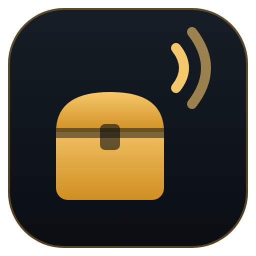

# LootLogger

**Loot logger para Albion Online. Veja quem pegou o quê, de quem e quando.**

Baixa direto o instalador da versão mais nova.

## Como instalar

1. Clique em **Baixar para Windows**, logo acima.
2. Abra o arquivo **LootLogger-win-Setup.exe** que baixou.
3. Pronto. O app abre sozinho e se atualiza sozinho daqui pra frente.

> [!WARNING]
> **O Windows mostrou "O Windows protegeu o computador"?**
> Clique em **Mais informações** e depois em **Executar assim mesmo**.

> [!NOTE]
> **Ele pede administrador ao abrir.** É normal: é assim que ele lê o loot do jogo. Funciona com ExitLag e não precisa de Npcap.

## O que ele faz

| | |
|---|---|
| 📊 **Painel** | Itens capturados, última hora, valor estimado e eventos recentes |
| 📋 **Loot Log** | Quem pegou cada item, de quem, em qual mapa e quando, com busca e filtros |
| 📦 **Comparar Baú** | Junta os logs de várias pessoas com o log do baú da guild: quem guardou, quem está devendo e quem morreu com o item |
| ⚔️ **Dano** | Dano, DPS, cura e dano recebido da sua party (ou só seu), com lutas salvas |
| 💾 **CSV** | Exporta no formato que as guilds já usam. Cada sessão também é salva sozinha |
| ⚙️ **Configurações** | Modo Party e português/inglês |

Só lê o tráfego de rede do jogo. Não mexe no cliente do Albion.

## Dúvidas

<b>Parou de registrar depois de um patch do jogo</b>

 

Os códigos de rede do Albion mudam às vezes depois de um patch. Normalmente sai uma versão nova do app, que se instala sozinha.

Dá também para ajustar os códigos sem esperar, em `%AppData%\LootLogger\codes.json` (é criado na primeira vez que o programa abre).

<b>Onde ficam os arquivos</b>

 

- Configurações, lista de itens e gravações: `%AppData%\LootLogger`
- Sessões exportadas: `Documentos\LootLogger\Sessões` (dá para trocar em Configurações)
- Lutas salvas do medidor de dano: `%AppData%\LootLogger\lutas-salvas.json`
- Erros inesperados: `%AppData%\LootLogger\erros.log`

<b>Quero usar sem instalar</b>

 

Na [página da versão mais nova](https://github.com/vitorvic/LootLogger/releases/latest), baixe o **LootLogger-win-Portable.zip**, extraia e abra o `LootLogger.exe`. Essa versão não se atualiza sozinha.

<b>Para desenvolvedores</b>

 

**Requisitos:** Visual Studio 2026 Community com a carga ".NET desktop development" (.NET 10).

**Rodar pelo código:**

1. Abra o Visual Studio (ou o PowerShell) como administrador e abra `LootLogger.slnx`.
2. Escolha `LootLogger.App` como projeto de inicialização.
3. Aperte F5.

Testes: `dotnet test` na pasta do projeto.

**Estrutura:**

| Pasta | O que tem |
|---|---|
| `src/LootLogger.Protocol` | Leitura do protocolo Photon do jogo |
| `src/LootLogger.Capture` | Captura de pacotes |
| `src/LootLogger.Core` | Regras do loot, CSV, Comparar Baú, lista de itens |
| `src/LootLogger.App` | O programa (WPF) |
| `tests/LootLogger.Core.Tests` | Testes |

---

GPL-3.0. Veja [LICENSE](LICENSE) e [THIRD-PARTY-NOTICES.md](THIRD-PARTY-NOTICES.md). Projeto de fã, sem vínculo com a Sandbox Interactive GmbH. Albion Online é marca da Sandbox Interactive.
